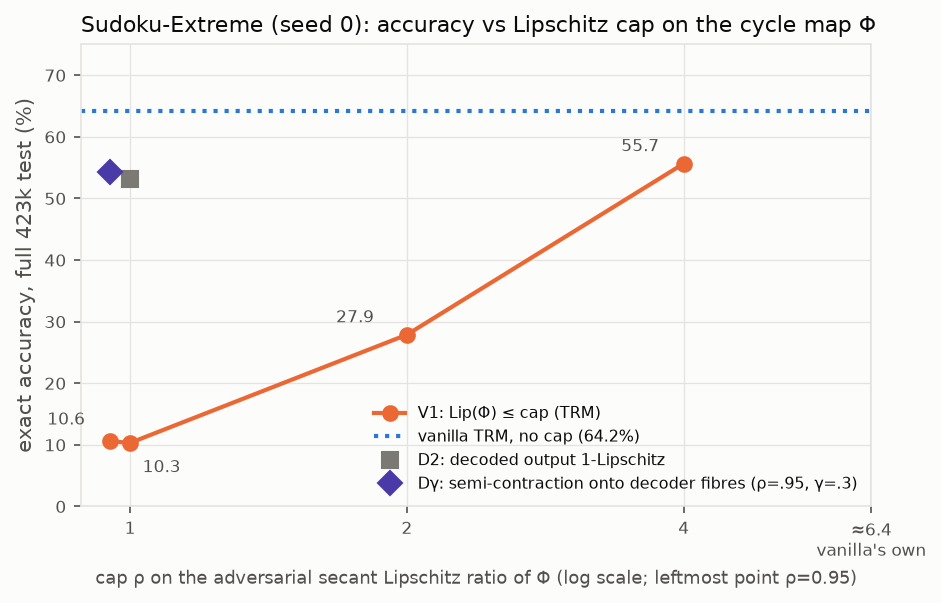
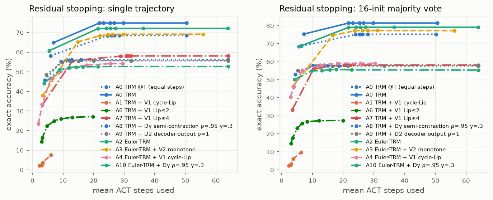

# Contraction-type regularizers for Tiny Recursive Models on Sudoku-Extreme

This repository trains Tiny Recursive Models (TRM) on Sudoku-Extreme with penalties that push the recursive
latent update towards a contraction, and measures what they do. Eleven arms are compared under one reduced
training budget: plain TRM, a Lipschitz cap on TRM's cycle map at four strengths, a damped "Euler-TRM" update
with a learned time embedding, alone and combined with a monotone (one-sided Lipschitz) vector-field penalty, two
penalties that only constrain the part of the state the answer decoder reads, and the Lipschitz cap and one decoder
penalty on Euler-TRM (A4, A10). Every arm except A5 (full-test accuracy and training metrics only; see *Missing
evaluations*) is evaluated for accuracy, fixed-point residuals, Jacobian-based contraction measures, accuracy from
many random starting states, and residual-based stopping. Every Lipschitz cap that binds lowers accuracy (three seeds
at cap 0.95 on TRM; one seed at caps 1, 2 and 4 and for the cap on Euler-TRM). Euler-TRM
without a penalty (h = 0.5 plus the learned time embedding; no arm separates the two) gains 2.98 ± 2.30 points over
TRM at the same 35k steps (A0@T) on three paired seeds, which is not significant at n = 3, and is 2.23 ± 2.33 points
below TRM trained for 45k steps (paired per seed −2.44, −4.45, +0.20). The monotone penalty on Euler-TRM costs
4.85 ± 4.65 points against Euler-TRM from the standard start (10.16 on one seed), which puts it below TRM at equal
steps on average (61.93 vs 63.80 on the 100k subset; paired −1.87 ± 2.74, not significant, and above TRM on seed 0).
In exchange, from fully random starts, all 16 starting states (one
canonical and 15 random) return the same board for 56.70 ± 6.88% of puzzles. In the other arms that learned the task,
the arm means are at most 10.47% (one A0@T seed reaches 29.80%). From starts close to the canonical one, the gap to
the other Euler-TRM arms is much smaller, but TRM stays well below A3 on average (57.10 ± 5.89% for A3, against
23.37 ± 25.13% for A0@T and 23.20 ± 13.72% for A0; on seed 2, A0@T is level with A3 at 52.20 vs 50.30; see
*Random starts*).

## Credit

The code builds on the official TRM implementation,
[SamsungSAILMontreal/TinyRecursiveModels](https://github.com/SamsungSAILMontreal/TinyRecursiveModels)
(MIT license, Copyright (c) 2025 Samsung Electronics Co., Ltd.), at upstream commit `c011037`. The git
history keeps the upstream commits unchanged; the work described here sits in the commits on top of them.
TRM is described in

* Alexia Jolicoeur-Martineau, *Less is More: Recursive Reasoning with Tiny Networks*, 2025,
  [arXiv:2510.04871](https://arxiv.org/abs/2510.04871),

which builds on the Hierarchical Reasoning Model (HRM, [arXiv:2506.21734](https://arxiv.org/abs/2506.21734)).
Upstream TRM's code is in turn based on the [HRM code](https://github.com/sapientinc/HRM) and the
[HRM analysis code](https://github.com/arcprize/hierarchical-reasoning-model-analysis) of the ARC Prize.
The upstream README, including its ARC-AGI and Maze-Hard instructions, is kept in
[docs/UPSTREAM_README.md](docs/UPSTREAM_README.md).

Upstream model and config files are unchanged, except that `models/losses.py` gains code that only runs for the new
model; the new model, flags and regularizers are opt-in. Some defaults of shared scripts did change. `pretrain.py` now logs to wandb in offline mode, resumes automatically from
`<checkpoint_path>/last_state.pt`, aborts on a NaN loss, also saves the raw (non-EMA) final weights, writes
`metrics.jsonl` and `summary.json`, and stops if evaluation is configured but its data is missing.
`dataset/build_sudoku_dataset.py` seeds NumPy with 0 by default, whereas upstream was unseeded.

## The idea

**Fixed-point view.** TRM keeps a latent state `s = (z_H, z_L)`. One *cycle* `Φ` updates `z_L` six times and
then `z_H` once; one ACT step `Ψ` applies three cycles. At evaluation, the answer is decoded from `z_H` after 16
ACT steps; in training, upstream's learned halting (a halt head trained with binary cross-entropy on whether the
current answer is correct; the Q-learning continue loss is off, `no_ACT_continue: True`) gives each puzzle up to 16
deeply supervised ACT steps. Inference can be read as an iteration of `Ψ` towards a fixed point, from which
the answer is decoded. If `Φ` were a
contraction, that fixed point would be unique, would not depend on the starting state, and iteration would
reach it geometrically. The question tested here is whether imposing contraction-type properties during
training, as soft penalties, helps accuracy, and what it changes in convergence and in dependence on the
starting state.

**V1: Lipschitz cap on the cycle map.** Penalise `ReLU(log(‖Φ(s) − Φ(s′)‖ / ‖s − s′‖) − log ρ)` with
`ρ = 1 − η = 0.95` (A1), 1 (A5), 2 (A6) or 4 (A7). Norms are joint Euclidean norms over the whole state, in fp32.

**V2: Euler-TRM with a monotone field.** Euler-TRM replaces each update `z ← F(z, ·)` by
`z ← z + h·(F(z, · + τ(t)) − z)` with step `h = 0.5` and a learned time embedding `τ`: a zero-initialised linear
projection of sinusoidal features of the substep index `t` (33,280 extra parameters). This is an explicit Euler
step of `dz/dt = F(z) − z`; `h = 1` with `τ = 0` recovers TRM exactly (tested). V2 penalises
`ReLU(⟨V(s) − V(s′), s − s′⟩ / ‖s − s′‖² + μ)` for the joint vector field
`V(s) = (F(z_H, z_L + τ_H) − z_H, F(z_L, z_H + x + τ_L) − z_L)`. A one-sided Lipschitz constant `≤ −μ` makes
trajectories of the continuous flow approach each other at rate `μ`. Here `μ = −ln(1 − η)/h ≈ 0.103`. That rate
holds for the continuous joint flow `ds/dt = V(s)` with `τ` held fixed. The model instead takes block-sequential
explicit Euler steps (six `z_L` substeps per `z_H` substep, `h = 0.5`, a different `τ` at each substep), which
are guaranteed to inherit the contraction only under a stronger, sufficient condition, roughly `h‖J_V‖² < 2μ ≈ 0.2`
(see [models/regularizers.py](models/regularizers.py)).

**Decoder-aware penalties.** Two different starting states only need to agree on what the decoder reads, not on
the whole latent. Let `P` project the state onto the decoder-visible subspace: the answer tokens of `z_H`
projected on the centred row space of the output head, with `z_L` mapped to 0. D2 (A9) asks that the decoded part
of the next state be 1-Lipschitz in the full state, `‖P(Φ(s) − Φ(s′))‖ ≤ ‖s − s′‖`. Dγ (A8, A10) is a
semi-contraction onto the decoder fibres with leak tolerance γ:
`‖P(Φ(s) − Φ(s′))‖ ≤ ρ·sqrt(‖PΔ‖² + γ²‖(I − P)Δ‖²)` with `Δ = s − s′`, `ρ = 0.95` and `γ = 0.3`.

**How the penalties are applied.** At each training step, a fraction `reg_frac` of the batch rows is regularized
(0.25 by default, 0.125 for the Dγ arms A8 and A10). Their pairs `s′ = s + δ` are adversarial: `δ` comes from one
(V1, D2, Dγ) or three (V2, after one step that estimates the gain of `F`) power-iteration steps per training step
that maximise the constrained quotient, warm-started per puzzle across ACT steps. The radius is log-uniform in
5–20% of `‖s‖`. For Dγ it is 5–20% of `‖W_γ s‖` in the metric `W_γ = P + γ(I − P)`, and the state perturbation is
`W_γ⁻¹(r·d)`, up to 1/γ larger in the directions the decoder does not read.
The penalty weight λ follows dual ascent towards a 10% violation rate and is frozen during learning-rate warmup.
The regularizer runs outside the compiled training graph, on detached anchor states, with its own random number
generator. The main training path therefore consumes the same randomness in every arm, and arms that share a seed
are paired: same seed, same data order and same random-number stream. The initialisation is bitwise identical only
between runs initialised on the same GPU model, because the weights are initialised on the GPU and PyTorch's CUDA
random-number output for large tensors depends on the device (its number of multiprocessors). Seed 0 ran on two GPU
models: `A0_s0` and `A1_s0` finished on the RTX 4090 Laptop GPU (the GPU of their 5k-step pilots is not recorded),
`A5_s0` ran on it throughout, and `A2_s0`, `A3_s0`, A4 and A6–A10 ran on RTX 5080s. Seed-0 differences across GPU
models may therefore include an initialisation difference; seeds 1 and 2 ran on RTX 5080s only. All arms,
including A0, log the V1/V2 monitors during training (`mon/v1_*`, `mon/v2_*`, `mon/fpres`); the decoder-subspace
monitors (`mon/dec_*`) exist only for A4 and A6–A10, which ran on later code. The details are in the docstring of
[models/regularizers.py](models/regularizers.py).

**Related methods.** The adversarial pair search uses power iteration in the manner of adversarial Lipschitz
regularization (D. Terjék, *Adversarial Lipschitz Regularization*, ICLR 2020,
[arXiv:1907.05681](https://arxiv.org/abs/1907.05681)). Monotone (one-sided Lipschitz) operators give
unique fixed points in monotone operator equilibrium networks (E. Winston and J. Z. Kolter, *Monotone operator
equilibrium networks*, NeurIPS 2020, [arXiv:2006.08591](https://arxiv.org/abs/2006.08591)). Jacobian penalties on
fixed-point networks are studied in S. Bai, V. Koltun and J. Z. Kolter, *Stabilizing Equilibrium Models by Jacobian
Regularization*, ICML 2021 ([arXiv:2106.14342](https://arxiv.org/abs/2106.14342)).

## Arms

| Arm | Model | Constraint | Seeds | Overrides in `scripts/run_benchmark.sh` |
|---|---|---|---|---|
| A0 | TRM | none (monitoring only), 45k steps; **A0@T** is its 35k-step checkpoint | 0, 1, 2 | – |
| A1 | TRM | V1, Lip(Φ) ≤ 0.95 | 0, 1, 2 | `arch.reg_mode=cycle_lip arch.reg_eta=0.05` |
| A2 | Euler-TRM, h = 0.5 | none | 0, 1, 2 | `arch.flow=True` |
| A3 | Euler-TRM, h = 0.5 | V2, monotone field, μ ≈ 0.103 | 0, 1, 2 | `arch.flow=True arch.reg_mode=flow_mono arch.reg_eta=0.05` |
| A4 | Euler-TRM | V1, Lip(Φ) ≤ 0.95 | 0 | `arch.flow=True arch.reg_mode=cycle_lip arch.reg_eta=0.05` |
| A5 | TRM | V1, Lip(Φ) ≤ 1 | 0 | `arch.reg_mode=cycle_lip arch.reg_eta=0.0` |
| A6 | TRM | V1, Lip(Φ) ≤ 2 | 0 | `arch.reg_mode=cycle_lip ++arch.reg_rho=2.0` |
| A7 | TRM | V1, Lip(Φ) ≤ 4 | 0 | `arch.reg_mode=cycle_lip ++arch.reg_rho=4.0` |
| A8 | TRM | Dγ, ρ = 0.95, γ = 0.3 | 0 | `arch.reg_mode=dec_semi ++arch.reg_rho=0.95 ++arch.reg_gamma=0.3 arch.reg_frac=0.125` |
| A9 | TRM | D2, decoded output 1-Lipschitz | 0 | `arch.reg_mode=dec_out ++arch.reg_rho=1.0` |
| A10 | Euler-TRM | Dγ, ρ = 0.95, γ = 0.3 | 0 | `arch.flow=True arch.reg_mode=dec_semi ++arch.reg_rho=0.95 ++arch.reg_gamma=0.3 arch.reg_frac=0.125` |

Common setup for every arm: the TRM-MLP Sudoku recipe from the upstream README (5.03M parameters; 5.06M for the
Euler-TRM arms, whose time-embedding projection adds 33,280), with batch
256 instead of 768; constant learning rate 1e-4 after 2,000 warmup steps and EMA 0.999, as upstream; up to 16 ACT
steps in training (learned halting, as upstream), while the standard evaluation runs exactly 16; 35k optimizer steps.
`config/cfg_sudoku_bench.yaml` holds these settings (batch 256, 8,960 epochs = 35k steps, evaluation every 1,280
epochs = 5k steps). A0 continues to 45k steps as an approximately compute-matched control, since the penalised arms
spend extra forward and backward passes on the regularizer. On the same GPU and seed, V1 trains at about 0.68–0.72×
(0.68 on seeds 1 and 2, 0.72 on seed 0) and V2 at about 0.78× TRM's throughput (seeds 1 and 2), so 35k penalised
steps cost roughly 48–52k (V1) and 45k (V2) TRM steps: the match is close for V2, and V1 gets somewhat more compute
than A0. Throughput also varies by up to about 1.65× between runs on the same GPU model, so the match cannot be made
exact. With a constant learning rate, A0@T is A0's checkpoint at the
same 35k steps as the other arms.

## Main results

Exact accuracy (whole board correct) after 16 ACT steps, in %. The full test set has 422,786 puzzles and was
evaluated for seed 0. The fixed 100k-puzzle subset (standard error ≈ 0.15 pp) was evaluated for every run except
`A5_s0` (see *Missing evaluations*). The
three-seed arms show mean ± sample std. The last column runs inference for 64 ACT steps on a 25k subset (models
are trained with up to 16).
Source: [results/sudoku-contractive/report/benchmark.md](results/sudoku-contractive/report/benchmark.md) and the
per-run `eval_full.json`, `eval_100k.json` and `eval_ext64.json` files.

| Arm | Exact@16, full test (seed 0) | Exact@16, 100k subset | per seed (s0, s1, s2) | Exact@64, 25k subset |
|---|---|---|---|---|
| A0@T TRM, 35k | 64.20 | 63.80 ± 1.01 | 64.36, 64.41, 62.63 | 68.77 ± 0.55 |
| A0 TRM, 45k | 68.98 | 69.01 ± 0.98 | 69.15, 69.91, 67.96 | 75.07 ± 0.60 |
| A1 TRM + V1 (≤ 0.95) | 10.61 | 10.24 ± 0.23 | 10.49, 10.20, 10.03 | 11.28 ± 0.28 |
| A5 TRM + V1 (≤ 1) | 10.32 | – (not evaluated) | – | – (not evaluated) |
| A6 TRM + V1 (≤ 2) | 27.89 | 27.90 | 27.90 | 28.60 |
| A7 TRM + V1 (≤ 4) | 55.66 | 55.60 | 55.60 | 58.34 |
| A8 TRM + Dγ | 54.34 | 54.56 | 54.56 | 55.80 |
| A9 TRM + D2 | 53.13 | 53.18 | 53.18 | 54.58 |
| A2 Euler-TRM | 66.65 | 66.78 ± 1.35 | 66.72, 65.46, 68.16 | 72.62 ± 2.47 |
| A3 Euler-TRM + V2 | 65.08 | 61.93 ± 3.65 | 65.20, 62.58, 58.00 | 68.66 ± 5.05 |
| A4 Euler-TRM + V1 (≤ 0.95) | 51.21 | 51.35 | 51.35 | 55.46 |
| A10 Euler-TRM + Dγ | 50.72 | 50.82 | 50.82 | 52.26 |

Paired differences on the same seed (100k subset, exact@16, percentage points; from `benchmark.md`):

| Contrast | per seed | mean ± sd | t (2 dof) |
|---|---|---|---|
| V1 on TRM: A1 − A0@T | −53.86, −54.21, −52.60 | −53.56 ± 0.85 | −109.38 |
| Euler update: A2 − A0@T | +2.36, +1.05, +5.52 | +2.98 ± 2.30 | 2.24 |
| V2 on Euler-TRM: A3 − A2 | −1.51, −2.88, −10.16 | −4.85 ± 4.65 | −1.81 |

Accuracy falls as the Lipschitz cap tightens from 55.66 (cap 4) to 27.89 (cap 2), and plateaus near 10% for caps
≤ 1 (10.32 at cap 1, 10.61 at cap 0.95), against 64.20 for TRM at the same step count (full test, seed 0). The two
decoder-aware penalties, D2 and Dγ (53.13 and 54.34), land between the caps of 2 and 4 and stay about 10 points below
TRM. On Euler-TRM, V1 and Dγ cost about 15–16 points (A4, A10 vs A2, seed 0: −15.44 and −15.93 on the full test).



## Random starts, answer selection and residual stopping

`scripts/population_eval.py` runs every test puzzle (1,000-puzzle subset) from M = 16 starting states. Member 0 uses
TRM's canonical initial state; members 1–15 use fully random per-token states (`init rand`) or the canonical state
plus Gaussian noise of std 0.5 (`init noise:0.5`). The answer is then selected in several ways. *Single* is
member 0 only, the standard protocol. *Vote* is the majority over the 16 boards. *Min-residual* takes the member
with the smallest fixed-point residual `‖Ψ(s) − s‖ / ‖s‖`. *Member mean* is the average accuracy of the 16
members. *Unanimous* is the fraction of puzzles where all 16 members return the same board. Values for init `rand`
and 64 ACT steps, in %, mean ± sd over seeds where three exist (from `benchmark.md`):

| Arm | single | vote | min-residual | member mean | unanimous |
|---|---|---|---|---|---|
| A0@T TRM, 35k | 68.53 ± 1.56 | 74.50 ± 5.44 | 46.83 ± 30.09 | 45.53 ± 24.15 | 10.47 ± 16.76 |
| A0 TRM, 45k | 74.87 ± 1.18 | 82.37 ± 3.93 | 61.87 ± 7.59 | 57.20 ± 8.34 | 5.30 ± 7.71 |
| A1 TRM + V1 | 10.83 ± 0.78 | 12.47 ± 0.31 | 3.53 ± 2.77 | 9.78 ± 1.07 | 21.90 ± 18.35 |
| A2 Euler-TRM | 72.13 ± 2.17 | 76.63 ± 3.06 | 35.50 ± 25.95 | 33.48 ± 19.16 | 0.60 ± 1.04 |
| **A3 Euler-TRM + V2** | 69.20 ± 4.70 | 77.07 ± 6.76 | **81.00 ± 5.74** | **69.26 ± 6.20** | **56.70 ± 6.88** |
| A4 Euler-TRM + V1 | 54.20 | 58.50 | 47.50 | 38.46 | 2.20 |
| A6 TRM + V1 (≤ 2) | 27.20 | 27.10 | 0.00 | 1.77 | 0.00 |
| A7 TRM + V1 (≤ 4) | 58.10 | 58.10 | 1.10 | 3.66 | 0.00 |
| A8 TRM + Dγ | 56.10 | 57.30 | 18.40 | 14.81 | 0.00 |
| A9 TRM + D2 | 55.70 | 57.60 | 31.20 | 30.92 | 0.20 |
| A10 Euler-TRM + Dγ | 52.70 | 54.50 | 38.20 | 20.97 | 0.10 |

* **Agreement across starts (A3).** From fully random starts, with the V2 penalty, all 16 starts agree on the board
  for 56.70 ± 6.88% of puzzles (per seed 61.40, 59.90, 48.80). In every other arm with usable accuracy, the arm mean
  is at most 10.47 ± 16.76% (A0@T; per seed 0.00, 1.60, 29.80). A random start does about as well as the canonical
  one (member mean 69.26 vs single 69.20). For A2 without the penalty, random starts drop to 33.48 ± 19.16. Starts
  close to the canonical one (init `noise:0.5`) shrink the gap to the other Euler-TRM arms: unanimity is
  57.10 ± 5.89 for A3, 42.40 ± 14.75 for A2 (57.30 on seed 0), 41.80 for A4 and 47.90 for A10 (`benchmark.md`).
  TRM stays well below on average: 23.37 ± 25.13 for A0@T and 23.20 ± 13.72 for A0 (6.10 and 20.40 on seed 0;
  A0@T reaches 52.20 on seed 2, above A3's 50.30).
* **Min-residual selection (A3).** Picking the trajectory with the smallest residual reaches 81.00 ± 5.74%
  (per seed 86.30, 81.80, 74.90), 11.8 points above A3's own canonical start. It uses 16 trajectories, so the
  comparable baselines are the other 16-trajectory selectors: A2 reaches 79.17 ± 2.32 by vote and 78.50 ± 5.28 by
  min-residual from noisy starts, and A0 at 45k steps reaches 82.37 ± 3.93 by vote from random starts, comparable
  to A3's 81.00 ± 5.74 (A0 − A3 per seed: −7.0, +5.0, +6.1).
  From fully random starts, min-residual selection for TRM and plain Euler-TRM falls below their single canonical
  run on average: 46.83 ± 30.09 vs 68.53 for A0@T (per seed −54.3, −11.2, +0.4, so mixed in sign), 35.50 ± 25.95 vs
  72.13 for A2 and 61.87 ± 7.59 vs 74.87 for A0 (below on every seed for both). Their random starts often end on
  wrong boards with a smaller residual than the canonical run. From noisy starts it is above the single run for A2
  (78.50 vs 72.13; per seed +10.3, +2.8, +6.0), level for A0 (75.07 vs 74.87; 0.0, −1.0, +1.6) and below on average
  for A0@T, with mixed sign (67.20 vs 68.53; per seed −8.5, −2.1, +6.6).
* **Majority vote** helps TRM and Euler-TRM (A0@T 68.53 → 74.50, A2 72.13 → 76.63, A3 69.20 → 77.07), but not
  the V1-capped arms A6 and A7. For A0, A2 and A3, the vote share is a well-ranked confidence score
  (AUROC arm means 0.97–1.00 in `benchmark.md`; per seed (`pop_eval.json`) down to 0.93, for A2 seed 2 from random starts).
* **A1's agreement is not useful.** A1 shows 21.90 ± 18.35% unanimity, but its boards are mostly wrong: about 11% of
  puzzles are solved.

**Residual-based stopping.** Each trajectory stops at the earliest ACT step where its residual falls below τ, with a
maximum of 64 steps. With τ = 0.02 and init `noise:0.5`, the single-trajectory accuracy equals the 64-step accuracy
for A0, A2, A7, A8 and A9. For example, A0@T scores 68.53 ± 1.56 both ways, and its canonical trajectory stops after
26.83 ± 1.03 ACT steps on average instead of 64 (26.33 ± 1.89 averaged over all 16 members). Under V1 at ρ = 0.95 on
TRM (A1), the residual is already small after about 3 steps, before the answer is right, and A1's accuracy drops
from 10.83 to 2.40 with this rule. A4 (V1 at ρ = 0.95 on Euler-TRM) stops after about 17.7 steps and loses 0.8
points (54.20 to 53.40).



## Contraction diagnostics

`scripts/fixed_point_diagnostics.py` measures residuals on 1,000 test puzzles and, for 256 of them, the Jacobians of
the trained operators in fp32: `J_Ψ` at the step-16 state `s_16`, and `J_Φ` at the state entering the last cycle of
the next ACT step. They are estimated by power iteration, with 20 iterations for `σ_max(J_Ψ)` and `σ_max(J_Φ)` and
30 for the spectral radius, `λ_max(sym J_V)` and the decoder-subspace quotients. A power-iteration `σ_max` is a lower
bound: a state counted above a threshold is above it, while a state counted below it is not certified. None of the
penalties makes the cycle map `Φ` contractive in the local (Jacobian) sense at those states. The median `σ_max(J_Φ)`
is 2.16 ± 0.54 for A1, against 4.96 ± 0.65 for A0@T. In every evaluated arm, `σ_max(J_Φ)` exceeds 1 on 100% of
those puzzles, and in the V1 arms it also exceeds their cap ρ on all of them. The decoder-aware penalties bound other
quotients: for Dγ, the median `σ_max(P·J_Φ·W_γ⁻¹)` is 1.82 (A8) and 2.04 (A10), above ρ = 0.95 on every measured
state; for D2, the median `σ_max(P·J_Φ)` is 1.00 (A9), above 1 on 53% of them. A1's decoder-subspace rows in
`benchmark.md` (D1, D2, leak and `W_γ` quotients) come from seed 0 only; the diagnostics of `A1_s1` and `A1_s2` do
not include them. The ACT-step map `Ψ` behaves differently under V1 at ρ = 0.95 on TRM (A1): the median
`σ_max(J_Ψ)` estimate is 0.92 ± 0.01 and the estimate is below 1 on about 65% of the measured states (34–36% above
1 per seed; being a lower bound, it does not certify `σ_max(J_Ψ) < 1` there), whereas it exceeds 1 on every measured
state in every other arm, including A4 (V1 at ρ = 0.95 on Euler-TRM, median 23.64). The median `λ_max(sym J_V)` for A3 is 2.43 ± 0.10, which is positive,
whereas V2 targets ≤ −μ. The penalties hold the violation rate on the sampled adversarial secant pairs near the 10%
target (`viol (end)` in `benchmark.md`). They do not certify a global or local bound. The median spectral radius of
the ACT-step Jacobian, ρ(J_Ψ), has arm means from 0.76 to 1.14 (0.87 ± 0.35 for A0@T, 1.01 ± 0.02 for A3); per run
it ranges from 0.58 (A0, seed 0) to 1.26 (A0@T, seed 2). The seeds of A0 and A0@T fall on both sides of 1, and
A3's seeds are within 0.03 of 1 (0.995 to 1.025).
All rows are in [`benchmark.md`](results/sudoku-contractive/report/benchmark.md).

More figures: [in-training evaluation](results/sudoku-contractive/report/figs/eval_curves.png),
[accuracy vs ACT steps](results/sudoku-contractive/report/figs/act_steps.png),
[fixed-point residual](results/sudoku-contractive/report/figs/residual.png),
[contraction measures](results/sudoku-contractive/report/figs/contraction.png),
[training-time monitors](results/sudoku-contractive/report/figs/train_monitor.png). A standalone interactive summary
(no network access needed) is in
[results/sudoku-contractive/report/TRM_contraction_benchmark.html](results/sudoku-contractive/report/TRM_contraction_benchmark.html).

## Planned follow-up

[docs/CVPR_BENCHMARK_PLAN.md](docs/CVPR_BENCHMARK_PLAN.md) proposes the baselines, ablations, test-time protocols,
tasks and statistics needed to test these results properly, with a compute estimate for every row. None of it has
been run yet.

## Caveats

* **Reduced budget.** 35k steps at batch 256 is about 18% of the training examples in the upstream Sudoku recipe
  (50,000 epochs at batch 768, about 65k steps); A0 at 45k steps sees about 23%. Training also uses a seeded
  1,000-puzzle × 1,000-augmentation subset, because the paper's subset is unknown. Absolute accuracies (64–69% for
  TRM) are well below the paper's ~87%, likely because of the reduced budget, the smaller batch and the different
  subset; none of these was tested separately. The comparisons are between arms trained under identical conditions;
  whether they hold at full budget is not tested here.
* **Seeds.** A0–A3 have three seeds (0, 1, 2); A4–A10 have seed 0 only, so their differences carry no seed-variance
  estimate. With n = 3, the A2 − A0@T and A3 − A2 contrasts are not significant at conventional levels (t = 2.24 and
  −1.81 on 2 dof); only the V1 effect is unambiguous. A3's seed spread is large (58.00–65.20 on the 100k subset).
* **A3 versus A2.** The V2 penalty costs canonical-start accuracy: −4.85 ± 4.65 pp on the 100k subset (−10.16 on
  seed 2), 65.08 vs 66.65 on the full test (seed 0), and A3 is below TRM at equal steps on average (61.93 vs 63.80
  on the 100k subset; paired +0.85, −1.83, −4.63, mean −1.87 ± 2.74, t = −1.18, not significant). On seed 0, A3 is
  above A0@T on both the 100k subset (65.20 vs 64.36) and the full test (65.08 vs 64.20). The gains above concern
  agreement across random starts and min-residual selection over 16 trajectories, which cost 16 times the inference
  compute.
* **Full test set and raw-weight diagnostics are seed 0 only**, by design (`FULL_TEST_SEEDS=0`). Three-seed
  statistics use the fixed 100k subset. Population and Jacobian diagnostics use a 1,000-puzzle subset (Jacobians on
  256 of those puzzles).
* **Missing evaluations.** Some post-training evaluations were paused and are not in this repository:
  `A1_s0/diag_raw.json` and `A5_s0/diag_raw.json` (diagnostics of the non-EMA weights), and for A5 (`A5_s0`)
  `eval_100k.json`, `eval_ext64.json`, `diag.json` and `pop_eval.json`. A5 is reported only through its full-test
  accuracy and its training metrics, and it is absent from the population tables.
* **Soft constraints.** All penalties are soft, with violations held near 10% on sampled pairs (see *Contraction
  diagnostics*). The results describe these regularizers, not exactly contractive operators.
* **Hardware and code snapshots.** Runs used an RTX 4090 Laptop GPU and RTX 5080 GPUs (bf16), some with resumption
  from full training-state checkpoints. `summary.json` records the GPU each run finished on. Its `git_commit` field
  is the repository HEAD when the run finished, which can be later than the code the run loaded, and it refers to
  the development history of this code, which is not published. `A0_s0` records upstream `c011037` because it was
  launched from uncommitted changes on top of upstream; that commit is not the code that ran. This repository
  contains the final state of the code. Each launch of a run, including a resume, overwrites the run's code
  snapshot (model, loss and regularizer files). `A0_s0` and `A1_s0` were resumed at step 5,000 from 5k-step pilot
  runs whose code was not kept, so their snapshots cover steps 5,000 onward only. The snapshots show that the model
  and loss code are identical to this repository in every run, and that `models/regularizers.py` went through three
  versions: A0–A3 and A5 used the first, A4, A6, A7 and A9 the second, and A8 and A10 the final one. The pilot of
  `A1_s0` logged the same training metrics as runs on the first version. The pilot of `A0_s0` used an earlier
  `models/regularizers.py` (no `mon/gain_F` monitor before step 5,000), which affects only its training-time monitor
  values for the first 5,000 steps (and the training-monitor figure); its model code for those steps is not
  recorded. The method
  of each arm is unchanged across versions, but the final training-time monitor draws extra random numbers from
  the regularizer's generator (for the decoder-subspace monitors). A rerun with this code therefore samples
  different regularizer pairs in the penalised arms other than A8 and A10, and logs different monitor values in
  A0 and A2. The main training path (model, data order, ACT exploration) is unaffected. In `benchmark.md`, `train h`
  of `A0_s0` and `A1_s0` is the `train_s` of `summary.json`, which covers only the resumed segment and excludes the
  5k-step pilot, and `steps/s` divides all their steps by it: 7.03 h and 1.78 steps/s for `A0_s0`, 7.35 h and
  1.32 steps/s for `A1_s0`. Adding the pilot's logged wall time gives about 8.1 h (1.55 steps/s) and 8.7 h
  (1.12 steps/s). The A0 and A1 means of these two rows include these values.
* `figs/cap_sweep.png` and the HTML summary were made from the same run files with plotting code that is not
  included. Everything else in `report/` is regenerated by `scripts/summarize.py` (see below).

## Reproducing

**Environment.**

```bash
conda create -n trm-bench python=3.12 && conda activate trm-bench
pip install torch --index-url https://download.pytorch.org/whl/cu130   # pick the wheel matching your CUDA
pip install einops tqdm coolname pydantic argdantic wandb omegaconf hydra-core huggingface_hub numba pytest matplotlib
# Optional: the adam-atan2 CUDA extension. Without it, models/adam_atan2_torch.py (a pure-PyTorch port) is used.
```

Training logs to wandb in offline mode by default (`WANDB_MODE=offline`), and also writes `metrics.jsonl` and
`summary.json` to the run directory.

**Data.** `--seed` makes the 1,000-puzzle training subsample and its augmentations reproducible, and
`--source-revision` pins the revision of the Hugging Face dataset `sapientinc/sudoku-extreme` that the benchmark
used (without it, the latest revision is downloaded, as upstream). Test subsets are nested
(test1k ⊂ test10k ⊂ test25k ⊂ test100k). `dataset/sudoku-extreme-s0.sha256` holds the checksums of the arrays the
benchmark used:

```bash
python dataset/build_sudoku_dataset.py --output-dir data/sudoku-extreme-1k-aug-1000-s0 \
    --subsample-size 1000 --num-aug 1000 --seed 0 --source-revision 58942f96baeb572ca3127e2a9e9c70f330783d6b
for n in 1000 10000 25000 100000; do
  python dataset/make_test_subset.py --source data/sudoku-extreme-1k-aug-1000-s0 \
      --output data/sudoku-extreme-test$((n/1000))k --n $n --seed 0
done
sha256sum -c dataset/sudoku-extreme-s0.sha256
```

**Training and evaluation.** `scripts/run_benchmark.sh` is a resumable queue: rerunning it skips finished work and
resumes interrupted runs from `last_state.pt`. One iteration is 1,280 epochs, which is 5,000 steps at batch 256.
Once a run finishes, the queue calls `scripts/post_run.sh` for the final evaluations: `eval_100k.json`,
`eval_ext64.json`, `diag.json`, `pop_eval.json`, plus `eval_full.json` and `diag_raw.json` for the seeds listed in
`FULL_TEST_SEEDS`. The script picks the conda env `trm-bench`; set `CONDA_SH` to your `conda.sh` if conda is not on
`PATH`, or `TRM_CONDA_ENV=none` to use the current Python. The scripts stop with a message if neither works.

```bash
# A0-A3, three seeds (A0 runs 9 iterations = 45k steps, keeping its 35k checkpoint as A0@T)
FULL_TEST_SEEDS=0 SEEDS="0 1 2" ARMS="A0 A1 A2 A3" ITERS=7 A0_ITERS=9 scripts/run_benchmark.sh
# A4-A10, seed 0
FULL_TEST_SEEDS=0 SEEDS=0 ARMS="A4 A5 A6 A7 A8 A9 A10" ITERS=7 scripts/run_benchmark.sh
# final evaluations of a single finished run (extra steps get *_step<N>.json files)
FULL_TEST=1 scripts/post_run.sh checkpoints/sudoku-contractive/A0_s0 35000
```

A single run without the queue, e.g. V1 with the settings of `A1_s0` (the config defaults are the benchmark schedule:
batch 256, 8,960 epochs = 35k steps, evaluation every 1,280 epochs):

```bash
python pretrain.py --config-name cfg_sudoku_bench seed=0 arch.reg_mode=cycle_lip arch.reg_eta=0.05 \
    run_name=A1_s0 checkpoint_path=checkpoints/single/A1_s0
```

Use a checkpoint directory outside `checkpoints/sudoku-contractive/`: runs resume from any `last_state.pt` they find,
and the queue treats that directory as its own.

**Report.** `scripts/summarize.py` reads only the JSON/JSONL files of each run. Pointing it at the published runs
regenerates `report/benchmark.md` byte for byte, plus the six figures it references:

```bash
python scripts/summarize.py --root results/sudoku-contractive/runs --out reports/sudoku-contractive
# for your own runs: python scripts/summarize.py --root checkpoints/sudoku-contractive --out reports/sudoku-contractive
```

## Repository layout

| Path | Contents |
|---|---|
| `models/recursive_reasoning/trm_contractive.py` | TRM fork: Euler-TRM flags, operator API (`cycle` = Φ, `field` = V), anchors exported for the regularizer; defaults reproduce TRM |
| `models/regularizers.py` | V1, V2, D2, Dγ (and D1, visible block only) penalties, adversarial pair search, dual ascent, training-time contraction monitor |
| `models/adam_atan2_torch.py` | pure-PyTorch port of `adam-atan2` 0.0.3, used when the CUDA extension is unavailable |
| `pretrain.py`, `models/losses.py` | upstream training loop plus regularizer hook, full resume, JSONL metrics, `summary.json`, fixed-point residual metric |
| `config/cfg_sudoku_bench.yaml`, `config/arch/trm_contractive.yaml` | the upstream Sudoku MLP-T recipe made explicit at the benchmark schedule, plus the added flags |
| `dataset/build_sudoku_dataset.py` (`--seed`, `--source-revision`), `dataset/make_test_subset.py`, `dataset/sudoku-extreme-s0.sha256` | reproducible training subset, nested test subsets, checksums of the benchmark data |
| `scripts/evaluate.py` | checkpoint evaluation with accuracy at every ACT step up to K and Q-halt accuracy |
| `scripts/fixed_point_diagnostics.py` | residuals, σ_max and spectral radius of J_Ψ and J_Φ, λ_max(sym J_V), decoder-subspace quotients, init robustness |
| `scripts/population_eval.py` | multi-start populations, voting, min-residual selection, confidence (AUROC, ECE, selective accuracy), residual stopping |
| `scripts/run_benchmark.sh`, `scripts/post_run.sh`, `scripts/smoke.sh`, `scripts/summarize.py` | run queue, final evaluations, smoke test, report |
| `tests/` | CPU test suite |
| `results/sudoku-contractive/report/` | `benchmark.md`, `figs/`, standalone HTML summary |
| `results/sudoku-contractive/runs/<ARM>_s<seed>/` | per run: `summary.json`, `all_config.yaml` (full resolved config), `metrics.jsonl` (training metrics every 50 steps, in-training eval on test10k every 5,000 steps), `eval_*.json`, `diag*.json`, `pop_eval*.json`; files with `_step35000` are A0's 35k checkpoint (A0@T); `A0_s0/diag_census_step5000*.json` are small early diagnostics of A0's 5k checkpoint (250 and 50 puzzles, earlier version of the diagnostics script), not used in the report |
| `BENCHMARK.md` | short technical notes on the benchmark |
| `docs/UPSTREAM_README.md` | the upstream TRM README |
| `docs/CVPR_BENCHMARK_PLAN.md` | proposed follow-up benchmark (baselines, ablations, protocol, compute estimates); not yet run |
| `LICENSES/` | third-party license texts (adam-atan2, d3) |

Model weights are not included.

## Tests

```bash
CUDA_VISIBLE_DEVICES="" DISABLE_COMPILE=1 python -m pytest -q tests/
```

The suite runs on CPU in about a minute. It covers exact equivalence of `trm_contractive` with upstream TRM at
default flags (and of Euler-TRM at h = 1), the penalties on toy maps with known Lipschitz constants, the optimizer
port against its reference, the data and training pipeline, and the diagnostics. With the datasets built under
`data/` (see *Data*), the result is `270 passed, 1 skipped, 4 xfailed`. The skipped test needs a GPU. The four
strict xfails document two things. One is an upstream bug: `loss_type=softmax_cross_entropy` raises a `TypeError` in
`ACTLossHead`, for both `trm` and `trm_contractive`; the Sudoku recipe uses stablemax. The other is a known
limitation of a fallback in the V2 power iteration that the regularizer does not use. Without `data/`, the three
tests that read the real data are skipped as well: `267 passed, 4 skipped, 4 xfailed`.

## License

MIT, as upstream. See [LICENSE](LICENSE): the upstream copyright notice of Samsung Electronics Co., Ltd. is kept,
and the modifications in this repository are Copyright (c) 2026 Leo Brunswic. Third-party components keep their own
licenses (see [LICENSES/](LICENSES/README.md)): `models/adam_atan2_torch.py` and the reference in
`tests/test_adam_atan2_torch.py` are derived from [adam-atan2](https://github.com/imoneoi/adam_atan2) 0.0.3
(Apache License 2.0), and the HTML report inlines [d3](https://d3js.org) v7.9.0 (ISC license). Code and data that
upstream TRM inherited from earlier projects (HRM, ARC-AGI, ConceptARC) keep the terms of their original sources (see
[LICENSES/](LICENSES/README.md)).

## Citation

If you use this code, please cite TRM:

```bibtex
@misc{jolicoeurmartineau2025morerecursivereasoningtiny,
      title={Less is More: Recursive Reasoning with Tiny Networks}, 
      author={Alexia Jolicoeur-Martineau},
      year={2025},
      eprint={2510.04871},
      archivePrefix={arXiv},
      primaryClass={cs.LG},
      url={https://arxiv.org/abs/2510.04871}, 
}
```

and the Hierarchical Reasoning Model it builds on:

```bibtex
@misc{wang2025hierarchicalreasoningmodel,
      title={Hierarchical Reasoning Model}, 
      author={Guan Wang and Jin Li and Yuhao Sun and Xing Chen and Changling Liu and Yue Wu and Meng Lu and Sen Song and Yasin Abbasi Yadkori},
      year={2025},
      eprint={2506.21734},
      archivePrefix={arXiv},
      primaryClass={cs.AI},
      url={https://arxiv.org/abs/2506.21734}, 
}
```
