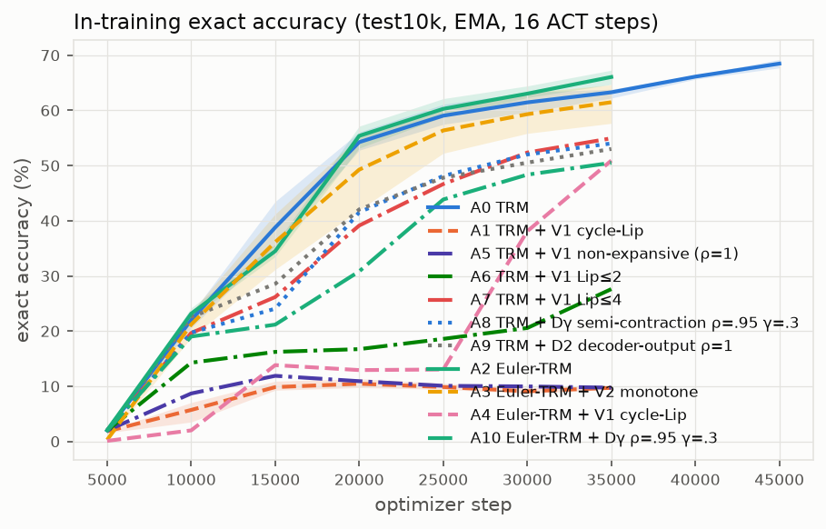
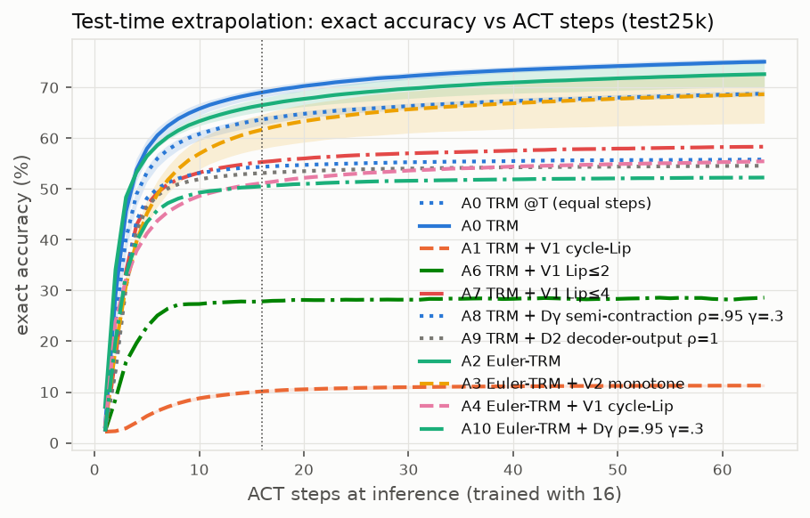
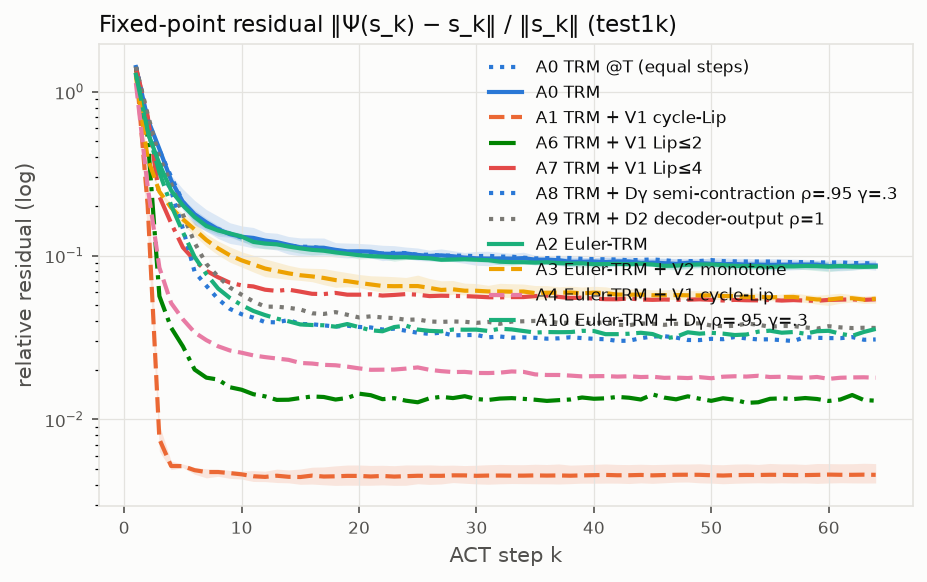
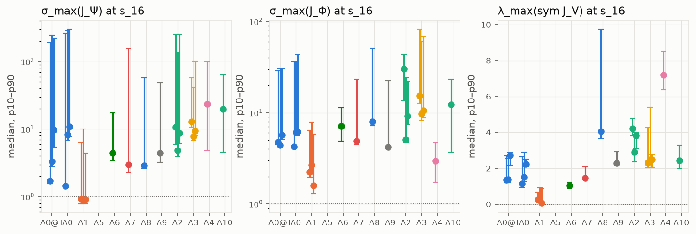
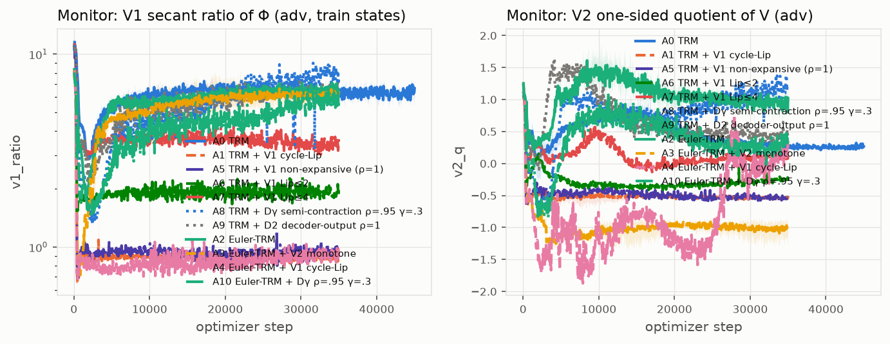

# Sudoku-Extreme: contractive recursive operator benchmark

Mean ± sample std over seeds (individual seeds in the per-seed table). Accuracies in %.

| metric | A0 TRM @T (equal steps) (n=3) | A0 TRM (n=3) | A1 TRM + V1 cycle-Lip (n=3) | A5 TRM + V1 non-expansive (ρ=1) (n=1) | A6 TRM + V1 Lip≤2 (n=1) | A7 TRM + V1 Lip≤4 (n=1) | A8 TRM + Dγ semi-contraction ρ=.95 γ=.3 (n=1) | A9 TRM + D2 decoder-output ρ=1 (n=1) | A2 Euler-TRM (n=3) | A3 Euler-TRM + V2 monotone (n=3) | A4 Euler-TRM + V1 cycle-Lip (n=1) | A10 Euler-TRM + Dγ ρ=.95 γ=.3 (n=1) |
|---|---|---|---|---|---|---|---|---|---|---|---|---|
| exact@16 (100k) | 63.80 ± 1.01 | 69.01 ± 0.98 | 10.24 ± 0.23 | – | 27.90 | 55.60 | 54.56 | 53.18 | 66.78 ± 1.35 | 61.93 ± 3.65 | 51.35 | 50.82 |
| cell acc@16 (100k) | 87.39 ± 0.37 | 89.00 ± 0.35 | 70.40 ± 0.23 | – | 76.25 | 84.55 | 84.77 | 84.37 | 87.89 ± 0.43 | 86.39 ± 1.12 | 83.76 | 83.53 |
| Q-halt exact@16 (100k) | 63.20 ± 0.97 | 68.42 ± 0.89 | 10.15 ± 0.21 | – | 29.18 | 54.87 | 54.10 | 52.39 | 66.04 ± 1.18 | 59.29 ± 3.59 | 50.48 | 49.51 |
| exact@16 (full 423k) | 64.20 | 68.98 | 10.61 | 10.32 | 27.89 | 55.66 | 54.34 | 53.13 | 66.65 | 65.08 | 51.21 | 50.72 |
| exact@16 (25k) | 63.71 ± 0.92 | 69.02 ± 0.96 | 10.14 ± 0.32 | – | 27.86 | 55.32 | 54.38 | 53.14 | 66.53 ± 1.35 | 61.69 ± 3.44 | 51.15 | 50.52 |
| exact@64 (25k) | 68.77 ± 0.55 | 75.07 ± 0.60 | 11.28 ± 0.28 | – | 28.60 | 58.34 | 55.80 | 54.58 | 72.62 ± 2.47 | 68.66 ± 5.05 | 55.46 | 52.26 |
| best step (25k) | 64.00 ± 0.00 | 64.00 ± 0.00 | 62.33 ± 1.15 | – | 64.00 | 64.00 | 64.00 | 64.00 | 64.00 ± 0.00 | 64.00 ± 0.00 | 64.00 | 64.00 |
| resid Psi@16 | 0.11 ± 0.00 | 0.11 ± 0.01 | 0.00 ± 0.00 | – | 0.01 | 0.06 | 0.04 | 0.04 | 0.11 ± 0.01 | 0.07 ± 0.01 | 0.02 | 0.04 |
| sigma_max Psi (med) | 4.92 ± 4.22 | 6.88 ± 4.86 | 0.92 ± 0.01 | – | 4.45 | 2.98 | 2.88 | 4.45 | 8.07 ± 2.95 | 10.05 ± 2.66 | 23.64 | 19.83 |
| sigma_max Phi (med) | 4.96 ± 0.65 | 5.50 ± 1.07 | 2.16 ± 0.54 | – | 7.09 | 4.89 | 8.00 | 4.18 | 14.85 ± 13.52 | 11.91 ± 3.06 | 2.96 | 12.27 |
| sigma P.J.P (D1, med) | – | – | 0.91 | – | 1.09 | 0.62 | 0.50 | 0.43 | – | – | 0.63 | 0.77 |
| sigma P.J (D2, med) | – | – | 1.79 | – | 3.24 | 2.10 | 0.71 | 1.00 | – | – | 2.29 | 0.92 |
| sigma P.J.(I-P) (leak, med) | – | – | 1.73 | – | 3.12 | 2.05 | 0.53 | 0.95 | – | – | 2.18 | 0.58 |
| sigma P.J.W^-1 γ=.3 (med) | – | – | 5.81 | – | – | – | 1.82 | – | – | – | – | 2.04 |
| rho(J_Psi) (med) | 0.87 ± 0.35 | 0.84 ± 0.35 | 0.76 ± 0.02 | – | 0.80 | 0.98 | 1.03 | 1.01 | 1.14 ± 0.10 | 1.01 ± 0.02 | 0.86 | 0.97 |
| fp32 rate Psi (med) | 0.52 ± 0.32 | 0.56 ± 0.37 | 0.35 ± 0.04 | – | 0.65 | 0.88 | 0.92 | 0.91 | 0.93 ± 0.05 | 0.90 ± 0.01 | 0.65 | 0.90 |
| frac sigma Phi > rho | 100.00 ± 0.00 | 100.00 ± 0.00 | 100.00 ± 0.00 | – | 100.00 | 100.00 | 100.00 | 100.00 | 100.00 ± 0.00 | 100.00 ± 0.00 | 100.00 | 100.00 |
| lam_max sym J_V (med) | 1.82 ± 0.78 | 1.62 ± 0.54 | 0.22 ± 0.13 | – | 1.04 | 1.45 | 4.06 | 2.29 | 3.65 ± 0.68 | 2.43 ± 0.10 | 7.21 | 2.44 |
| init agree@16 (sd .5) | 53.92 ± 4.61 | 58.83 ± 1.05 | 60.88 ± 3.60 | – | 17.75 | 2.85 | 35.60 | 53.85 | 60.03 ± 2.48 | 55.13 ± 3.94 | 48.75 | 60.70 |
| init agree@64 (sd .5) | 59.95 ± 5.53 | 65.88 ± 2.14 | 69.40 ± 1.14 | – | 19.85 | 2.95 | 37.40 | 57.95 | 66.68 ± 3.42 | 66.55 ± 4.20 | 57.40 | 72.60 |
| x/z | 0.29 ± 0.02 | 0.29 ± 0.02 | 0.56 ± 0.12 | – | 0.32 | 0.42 | 0.34 | 0.24 | 0.21 ± 0.01 | 0.25 ± 0.04 | 1.74 | 0.56 |
| lambda (end) | – | – | 0.51 ± 0.01 | 0.46 | 0.20 | 0.16 | 0.39 | 0.15 | – | 0.09 ± 0.02 | 1.25 | 0.25 |
| viol (end) | – | – | 10.12 ± 0.23 | 10.33 | 10.49 | 10.11 | 10.06 | 10.02 | – | 10.00 ± 0.43 | 9.95 | 10.19 |
| train steps | 3.5e+04 ± 0 | 4.5e+04 ± 0 | 3.5e+04 ± 0 | 3.5e+04 | 3.5e+04 | 3.5e+04 | 3.5e+04 | 3.5e+04 | 3.5e+04 ± 0 | 3.5e+04 ± 0 | 3.5e+04 | 3.5e+04 |
| train h | – | 4.48 ± 2.34 | 4.90 ± 2.30 | 8.54 | 2.81 | 4.65 | 3.10 | 4.60 | 2.29 ± 0.67 | 2.96 ± 0.92 | 2.84 | 3.12 |
| steps/s | – | 3.35 ± 1.69 | 2.31 ± 1.10 | 1.14 | 3.47 | 2.09 | 3.14 | 2.11 | 4.46 ± 1.11 | 3.48 ± 0.91 | 3.42 | 3.12 |
| peak GB | – | 10.37 ± 0.00 | 10.62 ± 0.04 | 10.57 | 10.64 | 10.64 | 10.59 | 10.64 | 10.39 ± 0.00 | 10.65 ± 0.00 | 10.65 | 10.59 |

## Paired differences (same seed)

| contrast | metric | per-seed Δ (pp) | mean Δ ± sd | t (n-1 dof) |
|---|---|---|---|---|
| V1 penalty (TRM): A1 − A0@T | exact@16 (100k) | -53.86, -54.21, -52.60 | -53.56 ± 0.85 | -109.38 |
| V1 penalty (TRM): A1 − A0@T | exact@64 (25k) | -57.01, -58.19, -57.28 | -57.49 ± 0.62 | -161.75 |
| V1 vs compute-matched TRM: A1 − A0 | exact@16 (100k) | -58.66, -59.71, -57.93 | -58.77 ± 0.90 | -113.52 |
| V1 vs compute-matched TRM: A1 − A0 | exact@64 (25k) | -63.11, -64.56, -63.71 | -63.79 ± 0.73 | -151.39 |
| V2 penalty (Euler-TRM): A3 − A2 | exact@16 (100k) | -1.51, -2.88, -10.16 | -4.85 ± 4.65 | -1.81 |
| V2 penalty (Euler-TRM): A3 − A2 | exact@64 (25k) | -0.06, +0.29, -12.12 | -3.96 ± 7.06 | -0.97 |
| Euler parameterization: A2 − A0@T | exact@16 (100k) | +2.36, +1.05, +5.52 | +2.98 ± 2.30 | 2.24 |
| Euler parameterization: A2 − A0@T | exact@64 (25k) | +4.06, +0.75, +6.75 | +3.85 ± 3.01 | 2.22 |
| V1 penalty (Euler-TRM): A4 − A2 | exact@16 (100k) | -15.36 | -15.36 ± nan | nan |
| V1 penalty (Euler-TRM): A4 − A2 | exact@64 (25k) | -17.20 | -17.20 ± nan | nan |
| V1 Lip<=2: A6 − A0@T | exact@16 (100k) | -36.45 | -36.45 ± nan | nan |
| V1 Lip<=2: A6 − A0@T | exact@64 (25k) | -39.99 | -39.99 ± nan | nan |
| V1 Lip<=4: A7 − A0@T | exact@16 (100k) | -8.76 | -8.76 ± nan | nan |
| V1 Lip<=4: A7 − A0@T | exact@64 (25k) | -10.26 | -10.26 ± nan | nan |
| D-gamma semi-contraction (TRM): A8 − A0@T | exact@16 (100k) | -9.79 | -9.79 ± nan | nan |
| D-gamma semi-contraction (TRM): A8 − A0@T | exact@64 (25k) | -12.80 | -12.80 ± nan | nan |
| D2 decoder-output Lipschitz: A9 − A0@T | exact@16 (100k) | -11.18 | -11.18 ± nan | nan |
| D2 decoder-output Lipschitz: A9 − A0@T | exact@64 (25k) | -14.02 | -14.02 ± nan | nan |
| D-gamma on Euler-TRM: A10 − A2 | exact@16 (100k) | -15.89 | -15.89 ± nan | nan |
| D-gamma on Euler-TRM: A10 − A2 | exact@64 (25k) | -20.40 | -20.40 ± nan | nan |
| Euler vs TRM under D-gamma: A10 − A8 | exact@16 (100k) | -3.74 | -3.74 ± nan | nan |
| Euler vs TRM under D-gamma: A10 − A8 | exact@64 (25k) | -3.54 | -3.54 ± nan | nan |

## Population eval — init `noise:0.5`, stop `fixed@64` (test1k, M=16; member 0 = canonical init)

| metric | A0 TRM @T (equal steps) | A0 TRM | A1 TRM + V1 cycle-Lip | A6 TRM + V1 Lip≤2 | A7 TRM + V1 Lip≤4 | A8 TRM + Dγ semi-contraction ρ=.95 γ=.3 | A9 TRM + D2 decoder-output ρ=1 | A2 Euler-TRM | A3 Euler-TRM + V2 monotone | A4 Euler-TRM + V1 cycle-Lip | A10 Euler-TRM + Dγ ρ=.95 γ=.3 |
|---|---|---|---|---|---|---|---|---|---|---|---|
| single | 68.53 ± 1.56 | 74.87 ± 1.18 | 10.83 ± 0.78 | 27.20 | 58.10 | 56.10 | 55.70 | 72.13 ± 2.17 | 69.20 ± 4.70 | 54.20 | 52.70 |
| vote | 75.30 ± 1.82 | 81.50 ± 1.47 | 12.13 ± 0.12 | 27.00 | 58.20 | 58.00 | 57.70 | 79.17 ± 2.32 | 77.30 ± 6.30 | 59.20 | 55.40 |
| min-resid | 67.20 ± 8.47 | 75.07 ± 0.45 | 6.90 ± 1.44 | 0.20 | 2.00 | 35.10 | 44.90 | 78.50 ± 5.28 | 81.07 ± 4.74 | 64.70 | 57.50 |
| member mean | 62.85 ± 5.04 | 68.97 ± 2.35 | 11.00 ± 0.64 | 7.28 | 6.19 | 30.10 | 42.29 | 70.26 ± 3.51 | 69.38 ± 5.90 | 54.51 | 52.10 |
| unanimous | 23.37 ± 25.13 | 23.20 ± 13.72 | 37.23 ± 2.94 | 0.00 | 0.00 | 0.00 | 2.10 | 42.40 ± 14.75 | 57.10 ± 5.89 | 41.80 | 47.90 |
| distinct/16 | 6.52 ± 0.79 | 5.75 ± 0.38 | 2.40 ± 0.13 | 11.94 | 15.57 | 9.51 | 5.92 | 5.37 ± 0.41 | 5.10 ± 0.35 | 5.97 | 3.12 |
| AUROC(vote share) | 0.99 ± 0.00 | 1.00 ± 0.00 | 0.56 ± 0.06 | 0.48 | 0.70 | 0.76 | 0.72 | 0.99 ± 0.01 | 0.98 ± 0.02 | 0.95 | 0.82 |
| AUROC(−resid) | 1.00 ± 0.00 | 1.00 ± 0.00 | 0.03 ± 0.01 | 0.18 | 1.00 | 1.00 | 1.00 | 1.00 ± 0.00 | 1.00 ± 0.00 | 1.00 | 1.00 |
| ECE(share) | 0.12 ± 0.05 | 0.13 ± 0.03 | 0.67 ± 0.01 | 0.13 | 0.49 | 0.15 | 0.09 | 0.09 ± 0.01 | 0.06 ± 0.03 | 0.05 | 0.25 |
| vote acc @ 50% coverage | 100.00 ± 0.00 | 100.00 ± 0.00 | 14.73 ± 2.48 | 25.80 | 69.80 | 76.20 | 73.80 | 99.93 ± 0.12 | 99.93 ± 0.12 | 96.80 | 80.80 |
| vote acc @ 80% coverage | 93.46 ± 1.56 | 99.17 ± 1.12 | 12.58 ± 0.63 | 27.75 | 62.38 | 67.38 | 67.25 | 96.67 ± 2.63 | 93.04 ± 7.18 | 73.00 | 65.62 |
| vote acc @ 90% coverage | 83.63 ± 2.06 | 90.52 ± 1.70 | 12.07 ± 0.50 | 27.67 | 60.56 | 63.22 | 62.00 | 87.89 ± 2.61 | 85.67 ± 7.29 | 65.67 | 60.44 |
| mean ACT steps | 64.00 ± 0.00 | 64.00 ± 0.00 | 64.00 ± 0.00 | 64.00 | 64.00 | 64.00 | 64.00 | 64.00 ± 0.00 | 64.00 ± 0.00 | 64.00 | 64.00 |
| latent dispersion of endpoints | 0.19 ± 0.06 | 0.19 ± 0.02 | 0.01 ± 0.00 | 0.21 | 0.54 | 0.32 | 0.21 | 0.17 ± 0.03 | 0.08 ± 0.02 | 0.02 | 0.07 |

## Population eval — init `noise:0.5`, stop `resid<0.02` (test1k, M=16; member 0 = canonical init)

| metric | A0 TRM @T (equal steps) | A0 TRM | A1 TRM + V1 cycle-Lip | A6 TRM + V1 Lip≤2 | A7 TRM + V1 Lip≤4 | A8 TRM + Dγ semi-contraction ρ=.95 γ=.3 | A9 TRM + D2 decoder-output ρ=1 | A2 Euler-TRM | A3 Euler-TRM + V2 monotone | A4 Euler-TRM + V1 cycle-Lip | A10 Euler-TRM + Dγ ρ=.95 γ=.3 |
|---|---|---|---|---|---|---|---|---|---|---|---|
| single | 68.53 ± 1.56 | 74.87 ± 1.18 | 2.40 ± 0.10 | 26.00 | 58.10 | 56.10 | 55.70 | 72.13 ± 2.17 | 69.13 ± 4.82 | 53.40 | 52.50 |
| vote | 75.30 ± 1.82 | 81.50 ± 1.47 | 3.20 ± 0.26 | 26.70 | 58.20 | 58.00 | 57.70 | 79.17 ± 2.32 | 77.33 ± 6.26 | 59.20 | 55.80 |
| min-resid | 66.70 ± 8.00 | 71.73 ± 8.42 | 3.63 ± 0.76 | 6.50 | 4.50 | 36.00 | 43.90 | 77.90 ± 5.79 | 79.83 ± 6.36 | 61.70 | 56.80 |
| member mean | 62.85 ± 5.04 | 68.97 ± 2.35 | 2.47 ± 0.07 | 7.06 | 6.19 | 30.08 | 42.26 | 70.26 ± 3.51 | 69.26 ± 6.08 | 53.16 | 51.83 |
| unanimous | 23.37 ± 25.13 | 23.20 ± 13.72 | 1.83 ± 0.12 | 0.00 | 0.00 | 0.00 | 1.90 | 42.40 ± 14.75 | 57.00 ± 6.07 | 37.00 | 39.10 |
| distinct/16 | 6.52 ± 0.79 | 5.75 ± 0.38 | 14.93 ± 0.48 | 14.25 | 15.57 | 9.98 | 6.44 | 5.38 ± 0.41 | 5.32 ± 0.68 | 6.87 | 4.93 |
| AUROC(vote share) | 0.99 ± 0.00 | 1.00 ± 0.00 | 0.97 ± 0.01 | 0.84 | 0.70 | 0.87 | 0.84 | 0.99 ± 0.00 | 0.99 ± 0.01 | 0.98 | 0.96 |
| AUROC(−resid) | 1.00 ± 0.00 | 1.00 ± 0.00 | 0.64 ± 0.19 | 0.48 | 1.00 | 0.72 | 0.91 | 1.00 ± 0.00 | 0.94 ± 0.07 | 0.88 | 0.75 |
| ECE(share) | 0.12 ± 0.05 | 0.13 ± 0.03 | 0.08 ± 0.02 | 0.12 | 0.49 | 0.21 | 0.07 | 0.09 ± 0.01 | 0.07 ± 0.02 | 0.04 | 0.11 |
| vote acc @ 50% coverage | 100.00 ± 0.00 | 100.00 ± 0.00 | 6.40 ± 0.53 | 46.00 | 69.40 | 86.00 | 83.20 | 100.00 ± 0.00 | 100.00 ± 0.00 | 99.60 | 96.80 |
| vote acc @ 80% coverage | 93.46 ± 1.56 | 99.17 ± 1.12 | 4.00 ± 0.33 | 32.62 | 62.38 | 70.12 | 69.00 | 96.67 ± 2.63 | 93.62 ± 6.61 | 73.00 | 68.75 |
| vote acc @ 90% coverage | 83.63 ± 2.06 | 90.52 ± 1.70 | 3.56 ± 0.29 | 29.11 | 60.56 | 64.11 | 62.56 | 87.89 ± 2.61 | 85.78 ± 7.13 | 65.67 | 61.67 |
| mean ACT steps | 26.33 ± 1.89 | 26.61 ± 8.11 | 3.06 ± 0.06 | 8.32 | 21.03 | 15.11 | 21.56 | 27.31 ± 0.78 | 27.97 ± 1.15 | 18.24 | 17.71 |
| latent dispersion of endpoints | 0.19 ± 0.06 | 0.19 ± 0.02 | 0.01 ± 0.00 | 0.21 | 0.54 | 0.32 | 0.21 | 0.17 ± 0.03 | 0.08 ± 0.02 | 0.02 | 0.07 |

## Population eval — init `rand`, stop `fixed@64` (test1k, M=16; member 0 = canonical init)

| metric | A0 TRM @T (equal steps) | A0 TRM | A1 TRM + V1 cycle-Lip | A6 TRM + V1 Lip≤2 | A7 TRM + V1 Lip≤4 | A8 TRM + Dγ semi-contraction ρ=.95 γ=.3 | A9 TRM + D2 decoder-output ρ=1 | A2 Euler-TRM | A3 Euler-TRM + V2 monotone | A4 Euler-TRM + V1 cycle-Lip | A10 Euler-TRM + Dγ ρ=.95 γ=.3 |
|---|---|---|---|---|---|---|---|---|---|---|---|
| single | 68.53 ± 1.56 | 74.87 ± 1.18 | 10.83 ± 0.78 | 27.20 | 58.10 | 56.10 | 55.70 | 72.13 ± 2.17 | 69.20 ± 4.70 | 54.20 | 52.70 |
| vote | 74.50 ± 5.44 | 82.37 ± 3.93 | 12.47 ± 0.31 | 27.10 | 58.10 | 57.30 | 57.60 | 76.63 ± 3.06 | 77.07 ± 6.76 | 58.50 | 54.50 |
| min-resid | 46.83 ± 30.09 | 61.87 ± 7.59 | 3.53 ± 2.77 | 0.00 | 1.10 | 18.40 | 31.20 | 35.50 ± 25.95 | 81.00 ± 5.74 | 47.50 | 38.20 |
| member mean | 45.53 ± 24.15 | 57.20 ± 8.34 | 9.78 ± 1.07 | 1.77 | 3.66 | 14.81 | 30.92 | 33.48 ± 19.16 | 69.26 ± 6.20 | 38.46 | 20.97 |
| unanimous | 10.47 ± 16.76 | 5.30 ± 7.71 | 21.90 ± 18.35 | 0.00 | 0.00 | 0.00 | 0.20 | 0.60 ± 1.04 | 56.70 ± 6.88 | 2.20 | 0.10 |
| distinct/16 | 9.35 ± 3.88 | 7.64 ± 1.30 | 3.97 ± 2.21 | 15.87 | 16.00 | 13.38 | 8.86 | 11.36 ± 3.07 | 5.14 ± 0.43 | 8.81 | 11.54 |
| AUROC(vote share) | 0.98 ± 0.02 | 1.00 ± 0.00 | 0.53 ± 0.08 | 0.45 | 0.50 | 0.71 | 0.68 | 0.97 ± 0.03 | 0.98 ± 0.01 | 0.93 | 0.74 |
| AUROC(−resid) | 1.00 ± 0.00 | 1.00 ± 0.00 | 0.03 ± 0.01 | 0.18 | 1.00 | 1.00 | 1.00 | 1.00 ± 0.00 | 1.00 ± 0.00 | 1.00 | 1.00 |
| ECE(share) | 0.28 ± 0.20 | 0.26 ± 0.09 | 0.58 ± 0.11 | 0.21 | 0.52 | 0.35 | 0.11 | 0.42 ± 0.17 | 0.06 ± 0.03 | 0.15 | 0.23 |
| vote acc @ 50% coverage | 99.73 ± 0.46 | 100.00 ± 0.00 | 13.53 ± 2.00 | 28.60 | 57.40 | 72.20 | 69.80 | 99.87 ± 0.12 | 99.87 ± 0.23 | 93.00 | 72.00 |
| vote acc @ 80% coverage | 91.12 ± 7.55 | 99.08 ± 1.28 | 12.42 ± 0.81 | 27.50 | 59.00 | 66.00 | 65.62 | 92.08 ± 4.72 | 93.08 ± 7.25 | 72.12 | 63.50 |
| vote acc @ 90% coverage | 82.07 ± 6.95 | 91.37 ± 4.44 | 12.48 ± 0.42 | 27.67 | 58.89 | 61.44 | 62.22 | 83.56 ± 3.66 | 85.48 ± 7.65 | 65.00 | 59.22 |
| mean ACT steps | 64.00 ± 0.00 | 64.00 ± 0.00 | 64.00 ± 0.00 | 64.00 | 64.00 | 64.00 | 64.00 | 64.00 ± 0.00 | 64.00 ± 0.00 | 64.00 | 64.00 |
| latent dispersion of endpoints | 0.38 ± 0.24 | 0.34 ± 0.10 | 0.03 ± 0.03 | 0.40 | 0.68 | 0.46 | 0.35 | 0.48 ± 0.13 | 0.08 ± 0.02 | 0.06 | 0.43 |

## Population eval — init `rand`, stop `resid<0.02` (test1k, M=16; member 0 = canonical init)

| metric | A0 TRM @T (equal steps) | A0 TRM | A1 TRM + V1 cycle-Lip | A6 TRM + V1 Lip≤2 | A7 TRM + V1 Lip≤4 | A8 TRM + Dγ semi-contraction ρ=.95 γ=.3 | A9 TRM + D2 decoder-output ρ=1 | A2 Euler-TRM | A3 Euler-TRM + V2 monotone | A4 Euler-TRM + V1 cycle-Lip | A10 Euler-TRM + Dγ ρ=.95 γ=.3 |
|---|---|---|---|---|---|---|---|---|---|---|---|
| single | 68.53 ± 1.56 | 74.87 ± 1.18 | 2.40 ± 0.10 | 26.00 | 58.10 | 56.10 | 55.70 | 72.13 ± 2.17 | 69.13 ± 4.82 | 53.40 | 52.50 |
| vote | 74.50 ± 5.44 | 82.37 ± 3.93 | 3.60 ± 0.53 | 26.00 | 58.10 | 57.20 | 57.70 | 76.63 ± 3.06 | 77.17 ± 6.59 | 58.00 | 54.80 |
| min-resid | 48.83 ± 26.40 | 57.87 ± 11.02 | 3.10 ± 1.55 | 4.30 | 2.00 | 19.40 | 31.80 | 32.00 ± 25.46 | 79.77 ± 7.23 | 47.70 | 27.30 |
| member mean | 45.53 ± 24.15 | 57.19 ± 8.35 | 2.33 ± 0.30 | 1.69 | 3.66 | 14.79 | 30.88 | 33.48 ± 19.16 | 69.16 ± 6.36 | 37.36 | 20.89 |
| unanimous | 10.47 ± 16.76 | 5.30 ± 7.71 | 1.20 ± 0.96 | 0.00 | 0.00 | 0.00 | 0.20 | 0.60 ± 1.04 | 56.50 ± 7.23 | 1.90 | 0.10 |
| distinct/16 | 9.36 ± 3.88 | 7.64 ± 1.31 | 15.35 ± 0.26 | 15.98 | 16.00 | 13.59 | 9.38 | 11.36 ± 3.07 | 5.35 ± 0.74 | 9.54 | 12.36 |
| AUROC(vote share) | 0.98 ± 0.02 | 1.00 ± 0.00 | 0.98 ± 0.01 | 0.51 | 0.50 | 0.79 | 0.81 | 0.97 ± 0.03 | 0.99 ± 0.01 | 0.97 | 0.91 |
| AUROC(−resid) | 1.00 ± 0.00 | 1.00 ± 0.00 | 0.64 ± 0.19 | 0.48 | 1.00 | 0.72 | 0.91 | 1.00 ± 0.00 | 0.94 ± 0.07 | 0.88 | 0.75 |
| ECE(share) | 0.28 ± 0.20 | 0.26 ± 0.09 | 0.07 ± 0.01 | 0.20 | 0.52 | 0.36 | 0.14 | 0.42 ± 0.17 | 0.07 ± 0.02 | 0.19 | 0.28 |
| vote acc @ 50% coverage | 99.73 ± 0.46 | 100.00 ± 0.00 | 7.13 ± 0.95 | 29.60 | 57.40 | 77.20 | 81.00 | 99.93 ± 0.12 | 100.00 ± 0.00 | 96.40 | 88.00 |
| vote acc @ 80% coverage | 91.12 ± 7.55 | 99.08 ± 1.28 | 4.50 ± 0.66 | 27.00 | 59.00 | 67.25 | 68.38 | 92.08 ± 4.72 | 93.58 ± 6.71 | 71.75 | 67.00 |
| vote acc @ 90% coverage | 82.07 ± 6.95 | 91.37 ± 4.44 | 4.00 ± 0.59 | 27.00 | 58.89 | 61.78 | 63.33 | 83.56 ± 3.66 | 85.63 ± 7.40 | 64.44 | 60.44 |
| mean ACT steps | 23.95 ± 4.20 | 25.62 ± 8.91 | 3.45 ± 0.44 | 9.60 | 19.84 | 18.18 | 22.26 | 21.43 ± 4.23 | 28.73 ± 1.61 | 18.08 | 18.77 |
| latent dispersion of endpoints | 0.38 ± 0.24 | 0.34 ± 0.10 | 0.03 ± 0.03 | 0.40 | 0.68 | 0.46 | 0.35 | 0.48 ± 0.13 | 0.08 ± 0.02 | 0.06 | 0.43 |

## Per-seed results

| run | exact@16 (100k) | exact@64 (25k) | σmax Φ | λmax sym J_V | train h |
|---|---|---|---|---|---|
| A0@T_s0 | 64.36 | 68.60 | 4.80 | 1.36 | – |
| A0@T_s1 | 64.41 | 69.39 | 4.41 | 1.38 | – |
| A0@T_s2 | 62.63 | 68.33 | 5.69 | 2.71 | – |
| A0_s0 | 69.15 | 74.70 | 4.27 | 1.16 | 7.03 |
| A0_s1 | 69.91 | 75.76 | 6.07 | 1.50 | 3.98 |
| A0_s2 | 67.96 | 74.75 | 6.17 | 2.22 | 2.43 |
| A1_s0 | 10.49 | 11.58 | 2.23 | 0.28 | 7.35 |
| A1_s1 | 10.20 | 11.20 | 2.66 | 0.30 | 4.58 |
| A1_s2 | 10.03 | 11.04 | 1.58 | 0.07 | 2.78 |
| A5_s0 | – | – | – | – | 8.54 |
| A6_s0 | 27.90 | 28.60 | 7.09 | 1.04 | 2.81 |
| A7_s0 | 55.60 | 58.34 | 4.89 | 1.45 | 4.65 |
| A8_s0 | 54.56 | 55.80 | 8.00 | 4.06 | 3.10 |
| A9_s0 | 53.18 | 54.58 | 4.18 | 2.29 | 4.60 |
| A2_s0 | 66.72 | 72.66 | 30.28 | 4.21 | 1.90 |
| A2_s1 | 65.46 | 70.14 | 5.04 | 2.90 | 3.06 |
| A2_s2 | 68.16 | 75.08 | 9.24 | 3.84 | 1.91 |
| A3_s0 | 65.20 | 72.60 | 15.41 | 2.31 | 2.43 |
| A3_s1 | 62.58 | 70.42 | 9.79 | 2.50 | 4.01 |
| A3_s2 | 58.00 | 62.96 | 10.52 | 2.48 | 2.43 |
| A4_s0 | 51.35 | 55.46 | 2.96 | 7.21 | 2.84 |
| A10_s0 | 50.82 | 52.26 | 12.27 | 2.44 | 3.12 |

## Figures

### In-training eval

### Accuracy vs ACT steps

### Fixed-point residual

### Contraction measures

### Training-time contraction monitor

### Residual-based stopping time

